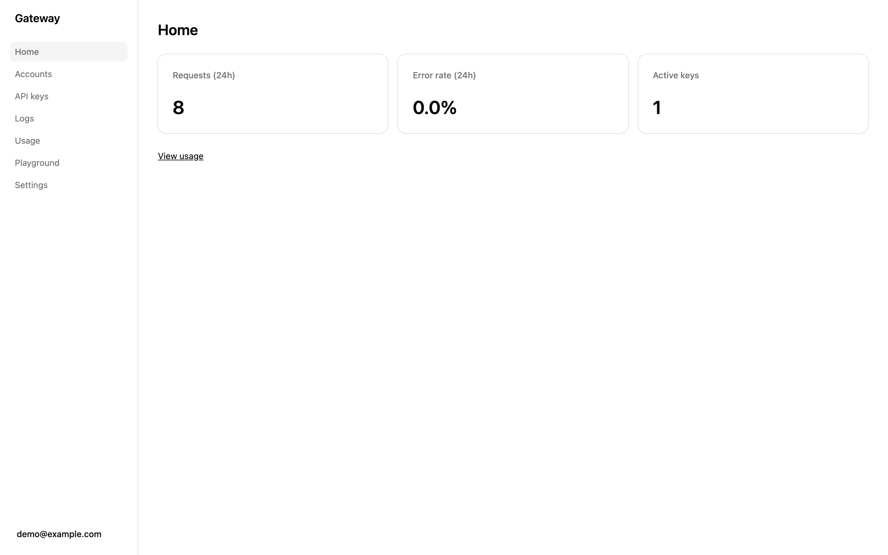

# Gateway

A self-hosted API gateway and dashboard for a creator-platform service you already run.

[](https://github.com/BlackPhoenixSlo/gateway/actions/workflows/ci.yml)
[](LICENSE)

Gateway sits in front of an upstream service that you supply. Each workspace creates its own scoped API keys
and calls `/v1/{account}/...`. Gateway checks the key, forwards the call with one upstream bearer token, and
records it. Your upstream stays private, your users never see its credential, and you get logs, usage, a
playground and an API reference without building them.

> **Not affiliated.** This project is unofficial and is not affiliated with, endorsed by or connected to any
> content platform or its operators. You are responsible for complying with the terms of the platforms you use.



[Accounts](docs/media/accounts.png) · [API keys](docs/media/keys.png) · [Playground](docs/media/playground.png) ·
[Logs](docs/media/logs.png) · [Usage](docs/media/usage.png) · [API reference](docs/media/api-reference.png) ·
[Video overview](docs/media/overview.webm)

## What you get

- **API keys.** `gk_` keys, shown once and stored as SHA-256 hashes. Create, rename, rescope and revoke from
  the dashboard; revocation takes effect on the next request.
- **Scopes and account allowlists.** A `read` key may only `GET` and `HEAD`; a `write` key may use any method.
  Each key can be limited to a list of accounts.
- **Proxy.** `/v1/{account}/<path>` goes to the upstream with your token. Status and body come back
  unchanged, along with `content-type`, `retry-after` and `x-ratelimit-*`. Per-key rate limit, 120 requests a
  minute by default.
- **Logs with redaction.** Every authenticated `/v1` request, with status, latency, key and account.
  Credential headers are never stored; secret-looking JSON keys and query parameters are masked. Bodies are
  kept for failed requests by default, and logs for 14 days.
- **Usage.** Requests and errors per day, broken down by key, account or endpoint.
- **Playground.** Pick an operation and an account, edit parameters and body, send, and copy the curl. It uses
  your dashboard session, so no key is pasted into the browser.
- **Merged OpenAPI reference.** `/openapi.json` holds Gateway's own routes plus the upstream's operations
  rewritten to `/v1/{account}/...`. `/docs` renders it as an interactive reference.
- **Workspace isolation.** Keys, logs and usage belong to one workspace, and every query is scoped to it.
  Sign-up is open, but a workspace reaches the upstream only after the operator links it.

## How it fits

```
 client (curl, script, browser)
        │  HTTPS · Authorization: Bearer gk_...
        ▼
 ┌──────────────┐  http   ┌────────────────────────┐  Bearer UPSTREAM_TOKEN  ┌────────────────────┐
 │ Caddy (TLS)  │───────▶ │ Gateway :4000          │───────────────────────▶ │ your upstream      │
 └──────────────┘         │ API + dashboard        │                         │ UPSTREAM_URL       │
                          └───────────┬────────────┘                         └────────────────────┘
                                      │
                          ┌───────────▼────────────┐
                          │ Postgres 17            │
                          │ keys, sessions, logs   │
                          └────────────────────────┘
```

The upstream is yours to supply. This repo does not include one, and connecting accounts happens there, not in
Gateway. It must answer three calls, each sent with `Authorization: Bearer $UPSTREAM_TOKEN`:

| Call | Gateway sends | Upstream returns |
|---|---|---|
| `listAccounts` | `GET /of-accounts` | A JSON array of accounts, each with a numeric `id`. |
| `forward` | `<METHOD> /of/<rest>` with `x-of-proxy-account-id: <account>` | Anything. It is passed through unchanged. |
| `openapi` (optional) | `GET /docs/json` | An OpenAPI 3 document. Operations under `/of/` tagged `of-api` are merged into `/openapi.json`. |

Everything a client sends to `/v1/{account}/<rest>` lands on `/of/<rest>`, and Gateway refuses any path that
would leave that prefix. The client's `authorization`, `cookie` and `host` headers are never forwarded. The
interface is specified in [docs/spec/plan-v2.md §4](docs/spec/plan-v2.md#4-upstream-adapter-appsapisrclibupstreamts)
and implemented in [apps/api/src/lib/upstream.ts](apps/api/src/lib/upstream.ts).
[apps/api/test/fake-upstream.ts](apps/api/test/fake-upstream.ts) is a small working example of all three.

## Deploy on a VPS (10 minutes)

You need a Docker VPS with 2 GB RAM or more (the image builds on the box), a DNS record for your hostname
pointing at it, and ports 80 and 443 open. With those ready, most of the ten minutes is the first build.

```sh
git clone https://github.com/BlackPhoenixSlo/gateway.git /opt/gateway
cd /opt/gateway/deploy
cp .env.example .env && chmod 600 .env
```

Fill in five values in `deploy/.env`:

| Variable | Value |
|---|---|
| `PUBLIC_URL` | `https://gw.example.com`: your hostname, no trailing slash |
| `POSTGRES_PASSWORD` | output of `openssl rand -hex 24` |
| `BETTER_AUTH_SECRET` | output of `openssl rand -base64 32` |
| `UPSTREAM_URL` | your upstream's origin, e.g. `https://upstream.example.com` |
| `UPSTREAM_TOKEN` | the bearer token your upstream issued (16 characters or more) |

Start the stack. Migrations run on every start, and Caddy fetches a certificate on first boot.

```sh
docker compose up -d --build --wait
curl -fsS https://gw.example.com/healthz
```

Open `https://gw.example.com` and sign up; that creates a workspace. Copy its slug from **Settings**, then
approve it from the VPS shell:

```sh
docker compose exec gateway node dist/db/link-team.js <slug>
```

Reload **Accounts** to see your upstream's accounts. The [full deploy guide](deploy/hostinger.md) covers the
firewall, updates, backups and restore, and troubleshooting. To expose no ports at all, run behind a
[Cloudflare Tunnel](deploy/hostinger.md#10-optional-cloudflare-tunnel-instead-of-open-ports) instead of Caddy.

## Develop locally

Requires Node 22.12 or newer, pnpm 10 and Docker.

```sh
pnpm install
docker compose up -d     # Postgres 17 on 127.0.0.1:5434, plus a gateway_test database
cp .env.example .env     # set BETTER_AUTH_SECRET, and UPSTREAM_TOKEN=dev-upstream-token
pnpm db:migrate
pnpm dev                 # API on http://localhost:4000, dashboard on http://localhost:5173
```

No upstream at hand? In a second terminal, run the fake one the tests use. It listens on port 3001, the
default `UPSTREAM_URL`, and serves one account with id `1`.

```sh
UPSTREAM_TOKEN=dev-upstream-token pnpm --filter @gateway/api exec tsx test/fake-upstream.ts
```

Register at http://localhost:5173, copy the workspace slug from **Settings**, and link it:

```sh
pnpm --filter @gateway/api link-team <workspace-slug>
```

Checks and build:

```sh
pnpm -r typecheck
pnpm -r test             # uses the gateway_test database
pnpm build               # both apps; in production the API serves the dashboard from apps/web/dist
```

[docs/getting-started.md](docs/getting-started.md) walks through the same steps in more detail.

## Use the API

Create a key on the **API keys** page and copy it; it is shown once. `GET /v1/accounts` lists the account ids
the key may use, and `GET /v1/whoami` shows the key's scope and allowlist. Then call the upstream through
Gateway:

```sh
curl -H "Authorization: Bearer gk_..." https://gw.example.com/v1/123/users/me
```

Gateway's own errors look like `{ "error": { "code": "...", "message": "...", "requestId": "req_..." } }`.
Upstream responses, errors included, come back as the upstream sent them. Every response carries an
`x-request-id` header.

A running Gateway serves the full reference at `/docs` and the spec at `/openapi.json`, with no login needed.
[docs/authentication.md](docs/authentication.md) covers keys, scopes, sessions, rate limits and every error
code.

## Security

- The upstream token lives only in the server's environment. Gateway adds it to outbound calls only, never
  logs it, and never forwards the client's own credentials upstream.
- API keys are stored as SHA-256 hashes, so the database alone does not yield usable keys.
- Dashboard writes need both an `Origin` matching `APP_URL` and an `x-dashboard: 1` header, and a bearer key
  always wins over a cookie with no fallback.

Report vulnerabilities privately as described in [SECURITY.md](SECURITY.md), not in a public issue.

## Contributing

Issues and pull requests are welcome. [CONTRIBUTING.md](CONTRIBUTING.md) lists the checks a pull request must
pass and the commit style.

## Licence

[AGPL-3.0-only](LICENSE). If you run a modified version as a service that others use over a network, you must
offer those users the source of your version.
